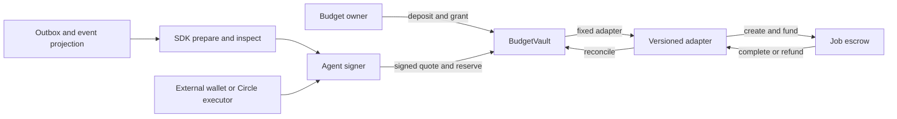

# Agent Commitments

**Shared USDC budgets and payment recovery primitives for agent teams building on Arc.**

An agent can reserve money, fund a job and lose an RPC response halfway through. Agent Commitments keeps the economic obligation separate from transaction delivery, so supported retries reuse the same operation instead of creating another payment. Multiple agents spend under constrained grants backed by one prefunded budget.

This toolkit complements Circle Wallets: Circle manages custody and submission; this project adds delegated budgets, signed commitments, reservation accounting and reconciliation. Contracts and SDK work without the reference API, console, database or LLM.

> **Experimental alpha.** Arc Testnet integration and a limited internal mainnet pilot are complete. Independent security review and external adoption remain pending. The owner-authorized pilot exception is not approval for broader production use. Payment receipts do not prove service quality. This is a community project, not an official Circle product.

## Start in your own project

Node >=22 is required. The release archive includes compiled network configuration, with no workspace dependencies or install scripts. The SDK is not yet on the npm registry.

```sh
npm install https://github.com/duclucky/agent-commitments/releases/download/v0.1.0-alpha.1/agent-commitments-sdk-0.1.0-alpha.1.tgz
```

```javascript
import { createArcTestnetClient, deriveCommitmentId } from "@agent-commitments/sdk";
import { keccak256, stringToHex } from "viem";

const client = createArcTestnetClient();
const grantId = keccak256(stringToHex("example-grant"));
const operationId = keccak256(stringToHex("example-operation"));
const id = deriveCommitmentId(client.chainId, client.vault, grantId, operationId);
const call = client.prepareDispatch(id);
console.log(call); // Calldata only; illustrative IDs. No signing or broadcast.
```

Preparing a call does not create a grant or reservation. See the [standalone starter](examples/sdk-starter/README.md), [integration guide](docs/integration.md) and [SDK API reference](docs/sdk-api.md) for roles and lifecycle.

## Reusable primitives

| Primitive | What builders can reuse |
|---|---|
| BudgetVault | Prefunded USDC; attenuated grants; provider/evaluator allowlists; deposit, per-job and concurrency caps |
| Signed commitments | EIP-712 quotes binding chain, vault, grant, parties, token, amount, terms, nonce and expiry |
| Versioned adapters | Reservation → escrow funding → terminal reconciliation with exact allowances |
| SDK | Prepare-only calls, stable IDs, typed inspection, refund simulation and backing checks |
| Runtime | Durable outbox, separate broadcast/receipt leases, restart handling and PostgreSQL projections |
| Failure tests | Accounting, replay, authority, concurrency, timeout and recovery cases |

The document workflow and console are examples. The reusable core consists of contracts, SDK, state model and failure tests that other builders can import or extend.



## Run locally

Requirements: Node >=22 (tested with 24.11.1), pnpm 10.15.1, Foundry 1.7.1 and Solidity 0.8.30. PostgreSQL 17 or Docker is needed only for integration tests; Chrome or Edge is needed for browser E2E.

```sh
git clone https://github.com/duclucky/agent-commitments.git
cd agent-commitments
pnpm install --frozen-lockfile
pnpm build
pnpm example:sdk
pnpm test:local-chain
```

The local chain test starts its own Anvil instance: deposit → grant → signed reserve → dispatch → provider budget → fund → submit → complete → reconcile. It checks the provider payout and ledger, then stops Anvil. MockUSDC and LocalAgenticCommerce are local fixtures; never use public Anvil keys on a shared network. Install, build and default tests do not broadcast to Arc. See [local development](docs/runbooks/local-development.md).

## Read the mainnet pilot

```sh
pnpm example:mainnet-pilot-readonly
pnpm console:mainnet
```

Open `http://127.0.0.1:4173/?mode=mainnet`. The loopback server checks chain ID, code hashes, binding, token decimals, ledger and backing at a pinned block. Receipt confirmation is checked against canonical blocks separately from economic status. RPC errors and snapshots over two minutes old show unverified evidence, never a demo fallback. `?mode=demo` selects explicitly simulated scenarios. This console observes two known pilot jobs; it is not a production indexer or public spending interface. See [mainnet quickstart](docs/quickstart-arc-mainnet.md).

## Money and authority

```text
D = A + R + E + S + W
```

Deposited (`D`) equals available (`A`), reserved (`R`), in escrow (`E`), settled (`S`) and withdrawn (`W`). Money is bigint in TypeScript and integer strings over HTTP: **1 USDC = 1_000_000 atomic ERC-20 units**. Arc's native 18-decimal gas and ERC-20 6-decimal interfaces expose the same USDC pool; never add the balances.

Child grants cannot expand parent authority, caps, expiry or allowlists. Reservations consume ancestor spending capacity. Revoke/pause block new obligations while preserving completion, refund and reconciliation of funded work. Worker timeout does not release escrow. Direct vault transfers do not credit the budget; the current vault has no recovery function for unassigned transfers.

## Deployments

| Network | Vault | Adapter | Scope |
|---|---|---|---|
| Arc Testnet · 5042002 | [0x0A1AbBf8b795e30F305C54C53A2404a595aF923a](https://explorer.testnet.arc.io/address/0x0A1AbBf8b795e30F305C54C53A2404a595aF923a) | [0x18EF2ad61947800e9F3574b65cee4fd2b4361a4a](https://explorer.testnet.arc.io/address/0x18EF2ad61947800e9F3574b65cee4fd2b4361a4a) | Internal alpha integration |
| Arc Mainnet · 5042 | [0x2415a87B0b9280C1989F03ceA9DC1c3644777862](https://explorer.arc.io/address/0x2415a87B0b9280C1989F03ceA9DC1c3644777862) | [0x0db5f0CC38F86e60FEbe495d4fFAF2Bb0288704d](https://explorer.arc.io/address/0x0db5f0CC38F86e60FEbe495d4fFAF2Bb0288704d) | Bound v2; limited pilot complete; empty budget |

Mainnet escrow: [0x19E14a1006d106882D4c24584AAA6Ce1771E4151](https://explorer.arc.io/address/0x19E14a1006d106882D4c24584AAA6Ce1771E4151). Adapter v1 is superseded. The `arcMainnetCanaryDeployment` export preserves a historical unbound snapshot; use `arcMainnetPilotDeployment` for the bound pilot.

The [internal pilot](docs/deployments/arc-mainnet-pilot-2026-10-12.md) deposited 0.01 USDC, exercised a refund, reused funds for a 0.005 USDC settlement and withdrew 0.005. Nineteen receipts are in [public evidence](deployments/arc-mainnet-pilot-evidence.json). Controlled-wallet activity is excluded from customer traction. See the [capability matrix](docs/capability-matrix.md).

## Checks and packaging

```sh
pnpm build
pnpm lint
pnpm test
pnpm test:invariants
pnpm test:failure
pnpm test:integration
pnpm test:e2e
pnpm test:mainnet-console
pnpm test:mainnet-pilot-policy
pnpm test:sdk-package
pnpm test:deployment-rehearsal
pnpm check:docs
```

`test:sdk-package` installs the release tarball into a fresh npm project without workspace links and checks ESM usage and TypeScript declarations. `pnpm pack:sdk` writes the archive and SHA256SUMS under `.release/`; it does not publish to npm. Source workspace packages remain private; the standalone archive is the distribution boundary.

`pnpm verify:arc-testnet` and `pnpm verify:arc-mainnet` are separate read-only RPC checks. First run `forge build --root contracts` for source/compiler/runtime comparison. No signer is needed.

## Limits

- Independent security review is pending. Circle Arc Studio was tool-assisted self-review with partial static analysis.
- Provider quotes require ECDSA EOAs; ERC-1271 signatures are unsupported. Transaction authority is a separate concern.
- Adapters target different pinned ERC-8183 ABIs. Mainnet covers a documented Draft subset, not full/future conformance. See [ADR 0005](docs/adr/0005-mainnet-agentic-commerce-escrow.md).
- Circle Developer-Controlled Wallets executor is testnet-only and not broadcast-verified. The mainnet pilot used Circle Agent Wallet CLI; these are distinct integrations.
- CCTP funding is a deterministic state model; no live route is enabled. Gateway, AP2 and x402 compatibility are not claimed.
- Evaluator decisions and issuer restrictions affect acceptance/refund liveness. Guarantees apply only to supported flows through these contracts.
- Hosted operation still needs ingress rate limits, TLS, monitoring and backups. No external customer adoption is verified.

Read [architecture](docs/architecture.md), [threat model](docs/threat-model.md), [recovery](docs/runbooks/recovery.md), [security](SECURITY.md), [contributing](CONTRIBUTING.md) and [changelog](CHANGELOG.md). Primary builder documentation is English; dated research/operator notes may retain their original Vietnamese text.

## License

Project-authored code is Apache-2.0. See [LICENSE](LICENSE) and [NOTICE](NOTICE) for attribution. Forks and contributions are welcome; this release does not imply Circle/Arc endorsement.
